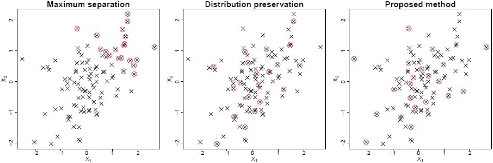
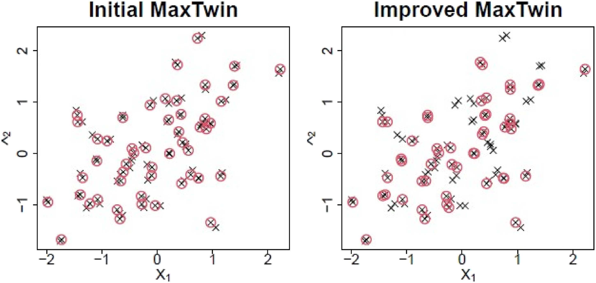
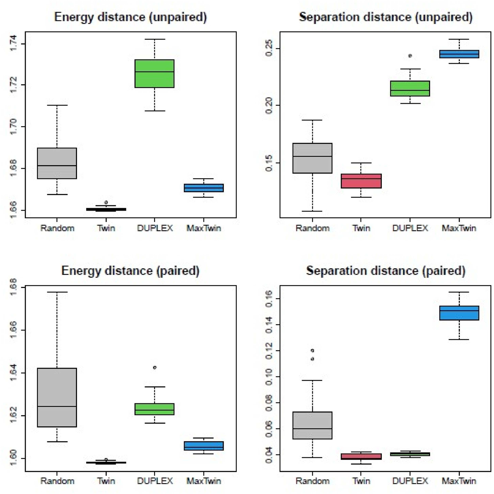

# pymaxtwin

Python implementation of **MaxTwin** ([Joseph and Cho, 2026](https://doi.org/10.1080/10618600.2026.2754089)), a deterministic train/test split that preserves the distribution of the data while keeping testing points away from training points.

<p align="center">
  
</p>
<p align="center"><em>Twenty testing points (red) chosen from 100 by maximum separation, SPlit, and MaxTwin.</em></p>

## Installation

```bash
pip install git+https://github.com/ChoYoungSeo/pymaxtwin.git
```

## Usage

```python
import numpy as np
from pymaxtwin import maxtwin

X = np.random.rand(100, 5)
Y = np.sin(X[:, 0]) + X[:, 1] ** 2

test_idx = maxtwin(X, Y, splitratio=0.2)  # sorted, 0-indexed
train_idx = np.setdiff1d(np.arange(len(X)), test_idx)
```

| Argument | Default | Description |
|---|---|---|
| `splitratio` | — | Test fraction; must be `1/r` for an integer `r >= 2` (0.5, 0.25, 0.2, ...) |
| `initialization` | `True` | Start twinning from the point closest to the centroid |
| `standardization` | `True` | Standardize the augmented data before twinning |

`initialmaxtwin()` runs the first step only, without the separation improvement.

## Results

<p align="center">
  
</p>
<p align="center"><em>Paired data: the improved algorithm assigns close pairs entirely to training or testing.</em></p>

<p align="center">
  
</p>
<p align="center"><em>MaxTwin keeps the energy distance low and the separation distance high on both unpaired and paired data.</em></p>

## R package

The same method is available on CRAN as [`maxtwin`](https://CRAN.R-project.org/package=maxtwin).

## Citation

```bibtex
@article{joseph2026maxtwin,
  author  = {Joseph, V. Roshan and Cho, Youngseo},
  title   = {A Robust Deterministic Data Splitting Method for Model Validation},
  journal = {Journal of Computational and Graphical Statistics},
  year    = {2026},
  doi     = {10.1080/10618600.2026.2754089}
}
```

## License

GPL-3.0-or-later
